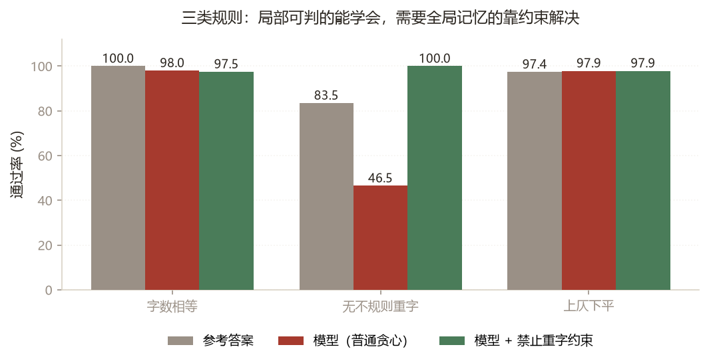

# 对联生成模型（seq2seq Transformer）

按《Attention Is All You Need》的**完整结构**（编码器 + 解码器 + 交叉注意力）实现的
中文对联生成模型。代码生成项目只用了论文的解码器，这个项目把另一半补齐。

**参数量 810,496**（原计划 50 万，因中文词表 9,014 字而调整，
理由见 [`docs/01-技术方案.md`](docs/01-技术方案.md) §2）。

---

## 结果速览

| 指标 | 数值 |
|---|---|
| 参数量 | **810,496**（`d_model=64` / `d_k=8` / `d_ff=256` / 2+2 层） |
| 训练 | 12,000 步 / 单卡 150 秒 / val **4.2385** / ppl **69.3** |
| 字数相等 | **98.0%**（参考 100%） |
| 上仄下平 | **97.9%**（参考 97.4%，**超过参考答案**） |
| 无不规则重字 | 46.5% → **100%**（加解码约束后） |



生成示例（测试集，模型未见过）：

```
春回大地千山秀  →  日照新春万里红    ✓✓✓
晚风摇树树还挺  →  明月落花心不圆    ✓✓✓
海内存知己      →  山中有是人        ✓✓✓
```

---

## 当前状态

| 阶段 | 内容 | 状态 |
|---|---|---|
| M0 | 下载数据集、确定词表 | ✅ 2026-11-15 |
| M1 | 数据管道（读取、词表、批处理） | ✅ 2026-11-16 |
| M2 | 模型实现（七段，含交叉注意力） | ✅ 810,496 参数 |
| M3 | 训练脚本（教师强制 + 论文式(3)） | ✅ val 4.2385 |
| M4 | 推理（贪心 + 采样） | ✅ |
| M5 | 规则评价（字数 / 重字 / 平仄） | ✅ 四条规则 + 平仄表 |
| M6 | 交互演示（上联 → 多副下联） | ✅ |

---

## 选定配置

```
vocab_size = 9014    d_model = 64     n_heads = 8    d_k = 8
d_ff       = 256     n_layers_enc = 2  n_layers_dec = 2
dropout    = 0.1     max_len = 40     总参数量 = 810,496
```

`d_model=64` 不是随便选的：只有它能让 `d_ff/d_model = 4.0`，
与论文的 `2048/512 = 4.0` 完全一致（结构保真度）；
注意力层与 FFN 的参数量比 1:2，也与论文一致。

---

## 快速开始

```powershell
# 1. 建词表（数据需自行下载到 data/raw/）
python couplet/src/prepare_data.py
python couplet/experiments/check_data.py       # 五项验收

# 2. 建平仄表（从语料反推，不用拼音库）
python couplet/src/tone.py

# 3. 训练（12000 步，约 150 秒）
python couplet/src/train.py --steps 12000 --eval-every 1000 --out results/run2

# 4. 规则评测
python couplet/src/evaluate.py --ckpt couplet/results/run2/best.pt --n 200

# 5. 交互演示
python couplet/webapp/server.py                # 打开 http://127.0.0.1:8765
```

---

## 文档

| 文档 | 内容 |
|---|---|
| [`docs/技术报告.md`](docs/技术报告.md) | **成果报告**：四组实验、局限、结论 |
| [`docs/01-技术方案.md`](docs/01-技术方案.md) | 任务定义、参数量约束推导、模型结构 |
| [`docs/02-训练流程.md`](docs/02-训练流程.md) | M0–M6 分阶段步骤 + 验收检查点 |
| [`docs/03-验收与评价.md`](docs/03-验收与评价.md) | 四条对联规则的口径 |
| [`docs/04-PyTorch训练循环入门.md`](docs/04-PyTorch训练循环入门.md) | 五个渐进练习 |
| [`docs/实验日志.md`](docs/实验日志.md) | 逐阶段记录，含踩过的坑 |

---

## 目录结构

```
couplet/
  src/          模型、数据管道、训练、推理、评价、平仄表
  experiments/  验收脚本（check_data / check_m2_1..7 / check_m3_1）
  webapp/       交互演示（零依赖 HTTP 服务 + 单页界面）
  docs/         六份文档 + figures/
  data/         数据集（不入 git）+ vocab.json + tone_table.json（入库）
  results/      run1、run2 的 train_log.csv（入库）；best.pt（不入库）
```

**纪律**：`couplet/src/` 与仓库原有的 `src/` 完全独立。
代码生成模型不受影响，这边改崩了也不影响那边。

---

## 三条值得记住的结论

**1. 中文任务的参数预算要先算词表**

嵌入表 = 词表 × d_model。9,014 × 64 = 576,896，占 810,496 的 71%。
这决定了 `d_model` 的上限，进而决定 `d_k`。反过来先定 `d_model` 再算总账会返工。

**2. 静默失败只能靠功能性验证发现**

掩蔽填 0（被屏蔽位置仍占 33% 权重）、多头拆分顺序反了、交叉注意力未连接——
这三处都不报错，只是变差。验证方法不是"跑通就行"，而是构造反例：
改一个位置看另一个位置变不变、把子层输出置零看是否退化成恒等。

**3. 规则的可学性取决于它需要多少信息**

| 规则 | 模型 | 为什么 |
|---|---|---|
| 末字平仄 | **97.9%** | 只看一个位置，局部可判 |
| 字数相等 | 98.0% | 由输入长度硬性决定 |
| 整句不重字 | **46.5%** | 需要记住整句用过什么，全局约束 |

前两条能学，第三条学不了——但一条解码约束就能把它提到 100%，代价仅 0.5 个百分点。

---

## 与代码生成项目的对照

| | 代码生成（原有） | 对联（本项目） |
|---|---|---|
| 任务 | 自回归语言建模 | 序列到序列（上联→下联） |
| 用了论文哪部分 | 只有解码器 | 编码器 + 解码器 + **交叉注意力** |
| 词表 | 96 个 ASCII 字符 | 9,014 个汉字 |
| 参数量 | 495,440 | 810,496 |
| d_model | 128 | **64**（词表导致，见 §2） |
| 嵌入表占比 | 2.5% | **71%** |
| 输出长度 | 无限制 | 由输入长度决定 |
| 评价 | 模糊 | 四条规则可自动检验 |
| 数据 | 自建（标准库源码） | 现成 77 万条 |
