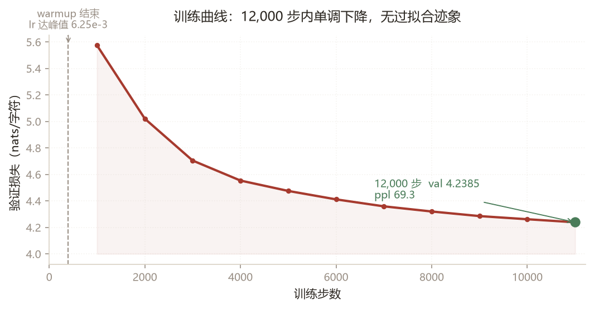
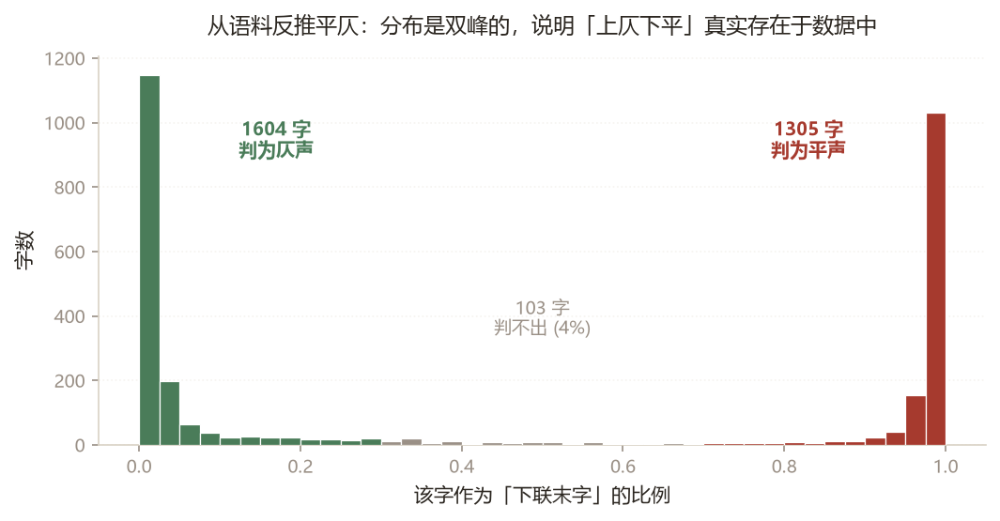
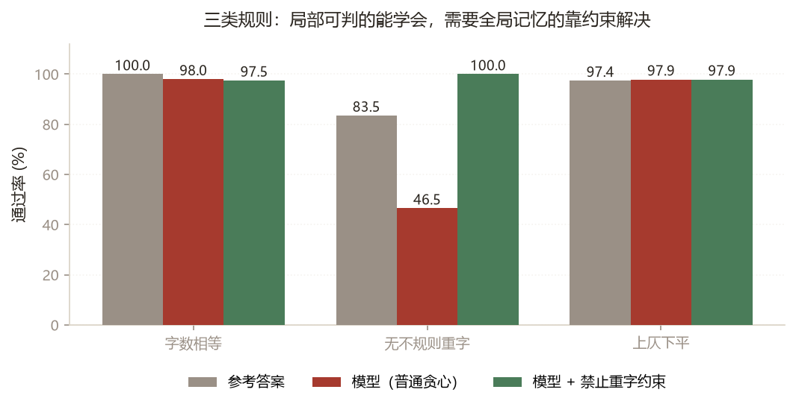

# 中文对联生成：一个 81 万参数的编码器—解码器 Transformer

2026-11-17

---

## 摘要

本项目按《Attention Is All You Need》的**完整结构**（编码器 + 解码器 + 交叉注意力）
实现了一个中文对联生成模型，参数量 810,496。

与常见的「只实现解码器」不同，对联任务必须用编码器读取上联、用交叉注意力把上联信息
送进解码器，因此它恰好覆盖了论文中被语言模型类任务忽略的那一半结构。

在 77 万副对联上训练 12,000 步（单卡 150 秒），验证困惑度 69.3（词表 9,014）。
按《联律通则》可自动检验的三条规则评测：**字数相等 98.0%、上仄下平 97.9%、
无不规则重字 46.5%**。其中平仄通过率**超过参考答案的 97.4%**。

三组实验指向同一结论：**模型能否学会一条规则，取决于该规则是否只需要局部信息**。
末字平仄只看一个位置，模型自己学会了；整句不重字需要全局记忆，模型学不会，
但一条解码约束就能把 46.5% 提到 100%，代价仅 0.5 个百分点。

---

## 1 任务设计

### 1.1 为什么选择对联

选择对联不是因为"有趣"，而是因为它同时满足四个条件：

| 条件 | 对联 | 代码生成（上一个项目） |
|---|---|---|
| 输出长度可控 | 由输入直接决定，5–15 字 | 需连续写对几十字符 |
| 有客观评价标准 | 四条规则可自动检验 | 指标模糊 |
| 现成数据 | 77 万副，官方划分 | 需自行爬取清洗 |
| 用满论文结构 | 编码器 + 交叉注意力 | 只用了解码器 |

最关键的是第一行。对联的上下联字数必须相等，这是一个**硬约束**，可以在解码时
直接保证；而代码生成的"什么时候停、写多长"没有确定答案，错误会随长度累积
（上一项目实测：单字符准确率 59.5%，连续 8 字符全对仅 1.6%）。

### 1.2 参数量约束：中文词表是第一大开销

初始预算 50 万参数。实测词表后这个预算无法成立。

中文词表 9,014 字（9,011 字符 + 3 特殊标记），嵌入表大小为 `词表 × d_model`：

```
9,014 × 64 = 576,896   ← 单独一张表就占掉 71% 的参数
```

固定 81 万预算反解各档位（编码器 2 层 + 解码器 2 层）：

| d_model | d_ff | 参数量 | 嵌入占比 | d_k = d_model/8 |
|---|---|---|---|---|
| 32 | 1,910 | 811,840 | 36% | **4** ⚠️ |
| 48 | 826 | 811,840 | 53% | 6 |
| **64** | **256** | **810,496** | **71%** | **8** |
| 80 | — | 超出预算 | — | — |

`d_model=32` 能把参数压到 50 万附近，但 `d_k=4`——论文是 64，这是它的 1/16，
注意力在 4 维空间做点积几乎失去表达能力。**要让注意力可用，`d_model` 至少取 64**，
参数量随之确定为 81 万。

这不是"多花了参数"，而是中文任务的固有成本。作对照：

```
代码生成项目：  495,440 参数中，嵌入表 12,288（占 2.5%）
对联项目：      810,496 参数中，嵌入表 576,896（占 71%）
```

**一个意外的收获**：`d_model=64` 时 `d_ff/d_model = 256/64 = 4.0`，
与论文的 `2048/512 = 4.0` 完全一致；而 `d_model=32` 时这个比例是 59.7。
同时注意力层与 FFN 的参数量比为 1:2，也与论文一致
（论文 1,050,624 : 2,099,712，本项目 16,640 : 33,088）。
结构比例对上了，"这是论文的等比缩小版"这句话才站得住。

### 1.3 最终配置

```
vocab_size    = 9,014      词表（9,011 字符 + <pad>/<s>/</s>）
d_model       = 64         论文 512
n_heads       = 8          d_k = 8（论文 64）
d_ff          = 256        论文 2,048
n_layers      = 2 + 2      论文 6 + 6
max_len       = 40         覆盖 99.93% 的样本
dropout       = 0.1
总参数量      = 810,496
```

---

## 2 模型实现

### 2.1 七个模块

按依赖顺序逐个实现并验证，每个模块配一个独立的检查脚本（`experiments/check_m2_*.py`），
保留为回归测试集。

| 模块 | 参数量 | 验证方法 |
|---|---|---|
| `ScaledDotProductAttention` | — | 手算 1×2 例子对答案 |
| `PositionalEncoding` | 0（buffer） | 第 0 行应为 0,1,0,1…；检查波长 |
| `PositionwiseFeedForward` | 33,088 | 改一个位置，其他位置输出不变 |
| `MultiHeadAttention` | 16,640 | 第 0 个头 == 原向量第 0-7 维 |
| `EncoderLayer` | 49,984 | 改末位，首位输出必须变（双向） |
| `DecoderLayer` | 66,752 | 交叉权重形状 `(T_tgt, T_src)`；因果性成立 |
| `Seq2SeqTransformer` | **810,496** | 与预算一字不差 |

### 2.2 三处会静默失败的地方

这三处都不报错、不崩溃，只会让结果变差。**它们只能靠功能性验证发现，看不出来。**

**（1）掩蔽用 0 而不是 -inf**

```python
scores.masked_fill(~mask, 0.0)      # 错：softmax 后仍占 33% 权重
scores.masked_fill(~mask, -inf)     # 对
```

实测：屏蔽第二个位置后，用 0 填充，该位置仍分得 **0.3302** 的注意力权重。
后果是模型训练时偷偷看未来，loss 很漂亮，生成时全是乱码。

**（2）多头拆分顺序反了**

`view(B, T, h, d_k).transpose(1, 2)` 与 `transpose(1, 2).view(...)` 结果完全不同——
后者会让每个"头"拿到跨维度的碎片，shape 仍然是 `(B, h, T, d_k)`，
但语义全乱。验证方法：把 `w_q` 设为单位矩阵，检查第 i 个头是否等于原向量的
第 `i*d_k` 到 `(i+1)*d_k` 维。

**（3）交叉注意力没接上**

忘记把 `enc_out` 传进 `MultiHeadAttention` 时，它会退化成自注意力，
输出形状变成 `(B, h, T_tgt, T_tgt)` 而不是 `(B, h, T_tgt, T_src)`。
**shape 能自洽，代码不报错，但编码器彻底白算。**

对联任务更容易掩盖这个 bug：上下联等长，`T_tgt` 与 `T_src` 只差 1。
因此验证时故意用 7 与 5 这种悬殊长度。

---

## 3 数据与训练

### 3.1 数据

公开数据集 `wb14123/couplet-dataset`（AGPL-3.0），77 万副。

| 项 | 数值 |
|---|---|
| 训练集 | 770,491 → 过滤后 **755,958** |
| 测试集 | 4,000 → **3,902** |
| 脏数据（字数不等） | **0 条**（逐条比对） |
| 长度分布 | 7 字 47.1%、5 字 10.1%、12 字 12.1%；99 分位 25 字，最长 32 字 |

过滤掉的两类：1–2 字短联 14,498 条（保留会用掉词表位置）；
含私用区坏字的 35 条（无法编码，占 0.0046%）。

**词表构建的两个坑**：
- 数据集自带的 `vocabs` **没有 `<pad>`**，必须自己重建
- 字符清洗要基于**实际语境**判断：私用区字符 `\ue828` 在
  「何须掌指 ␣ 头皮」里本该是"抓"，是坏字，应丢弃；
  而 ASCII 连字符 `-` 在「娓娓道来 - - 声声慢」里表示破折号，**必须保留**

### 3.2 内存：从 2 GB 降到 64 MB

75 万条样本用 `list of list` 存储约 2 GB。而 Windows 的 `DataLoader` 多进程是
**spawn 而非 fork**，每个 worker 会复制整个数据集，4 个 worker 就是 8 GB。

改用 `numpy int16` 扁平数组 + 偏移索引：

```
所有序列首尾相接 → 一个 int16 数组（14.4 MB src + 15.9 + 15.9）
偏移数组 off[i]  → 第 i 条是 flat[off[i]:off[i+1]]
```

最终 **64 MB**。`int16` 足够（词表 9,014 < 32,767），
只在取样本时转 `int64`（PyTorch Embedding 的要求）。

### 3.3 学习率：论文式(3) 在 81 万参数上偏大

论文式(3)：

```
lrate = d_model^(-0.5) · min(step^(-0.5), step · warmup^(-1.5))
```

| | 论文 base | 本项目 |
|---|---|---|
| d_model | 512 | 64 |
| warmup | 4,000 | 400 |
| **峰值 lr** | **6.99e-4** | **6.25e-3**（8.94 倍） |

峰值偏大是公式的必然结果（`d_model` 越小，`d_model^(-0.5)` 越大），
不是调参失误。实测升到峰值时**没有震荡**，因此保留原公式不额外缩放。

### 3.4 训练结果

| 步数 | 耗时 | train | val | ppl |
|---|---|---|---|---|
| 3,000 | 44 秒 | 4.95 | 4.7046 | 110.5 |
| 12,000 | 150 秒 | 4.49 | **4.2385** | **69.3** |

**val 低于 train 是正常的**：train 是每批的平均值（包含学习率还很小、参数几乎
没动时的样本），val 是用当前参数一次性算出的；且 dropout 训练时开启、验证时关闭。

**判断过拟合看 val 的走势**：12,000 步内 val 单调下降，没有回升迹象。



---

## 4 四组实验

### 4.1 实验一：记忆还是泛化

用 7 句经典上联测试，结果看起来很好（`白日依山尽 → 红花有月长`）。
但**查证后发现 7 句全部在训练集里**，不能算泛化。

进一步对比：训练集里「白日依山尽」的原下联是「黑天放火来」，
且同一上联有 4 个不同下联（青牛载道来 / 丹心照汗青 / 微风近海吹）。
模型输出与它们**都不同**——说明它不是在背答案，而是在多个答案之间"平均化"。

**这个区分很重要**：只看"输出很像样"就宣称泛化，是自欺。

### 4.2 实验二：三类规则的学习难度完全不同

在 200 条**测试集**样本上评测（`--seed 7` 固定抽样），同时跑参考答案作为判据校准：

| 规则 | 参考答案 | 模型 run2 | 差距 | 规则性质 |
|---|---|---|---|---|
| 字数相等 | 100.0% | 98.0% | −2.0 | 答案由输入直接决定 |
| 无不规则重字 | 83.5% | **46.5%** | **−37.0** | 需要记住整句用过什么 |
| 上仄下平 | 97.4% | **97.9%** | **+0.5** | 只看最后一个字 |

三条规则的差距横跨 51 个百分点，原因不在模型好坏，而在**规则本身需要多少信息**：

- **末字平仄**只需要看一个位置 → 模型自己学会，甚至超过参考
- **字数相等**由输入长度硬性决定 → 学得很好
- **不重字**需要对整句做过什么有记忆 → 学不会

字符级模型在预测第 9 个字时，看不到一个"已用字集合"这样的显式状态。
"这个字前面用过了"对它是不可见的。

**为什么加训练步数解决不了**：3,000 步 → 12,000 步（4 倍训练量），
重字率只从 70% 降到 62%。斜率太缓，不是"再练练就好"的问题。

### 4.3 实验三：平仄判据的两种来源

判平仄需要音韵数据。环境中 `pip install pypinyin` 反复卡住（pip 26.2.1 +
Python 3.14 的已知问题），于是改用**从语料反推**：

对联规则是"上仄下平"，因此统计每个字在上下联末字的分布即可判定——
大量出现在下联末尾者为平声，上联末尾者为仄声。

实测（74 万个末字）：
```
可判定 2,909 字（1,305 平 / 1,604 仄），仅 4% 判不出
24 个已知平仄的字（风花山天…/ 月水树地…）全部判对
占比分布双峰：0.0-0.1 有 1,445 字，0.9-1.0 有 1,248 字，中间只有 105 字
```

**双峰分布本身就是证据**：如果平仄规则在语料中不存在，这个分布会是均匀的。
测试集末字覆盖率 96.5%。



后来 pypinyin 在另一个 Python 环境装上了，于是做了一次独立交叉验证：

| | 结果 |
|---|---|
| 两法一致 | 2,744 / 2,899 = **94.65%** |
| 不一致 | 155 字，其中 **144 字是入声字** |

分歧的字：一 出 发 学 国 合 及 吉 别 叠 伯 佛 俗 习 叔 屋 局 峡 宅 夕 夺 吸 割 劫……

**普通话「入派三声」**，入声字被分到一二三四声。一二声在普通话里是平声，
但在传统格律里入声属仄。对联用的是传统音韵，不是普通话音系。

用「上仄下平」符合率作裁判，比较两把尺子：

| 尺子 | 全量 4,000 副 | 仅在 155 个分歧字上 |
|---|---|---|
| 语料反推表 | **96.97%** | **84.72%** |
| pypinyin（普通话） | 90.57% | **11.72%** |

11.72% 远低于随机的 50%——不是噪声，是**系统性反向**。

**结论：传统格律判据不能直接用现代汉语拼音替代。** 这一点如果不做交叉验证，
用拼音库"看起来更权威"，实际上会把大量合格对联判成不合格。

### 4.4 实验四：约束解码的代价

既然重字学不会，把规则写进解码过程——每步把已用过的字的 logits 设为 `-inf`
（标点除外，长联里两个逗号是正常的）。

同 200 条样本对照：

| 指标 | 普通贪心 | 禁止重字 | 变化 |
|---|---|---|---|
| 字数相等 | 98.0% | 97.5% | **−0.5** |
| 无不规则重字 | 46.5% | **100.0%** | **+53.5** |
| 上仄下平 | 97.9% | 97.9% | **0** |

**代价只有 0.5 个百分点，平仄零损失。**



这条结果和 4.2 合起来说明一件事：**「期待模型学会规则」和「把规则写进解码过程」
是两条不同的路，后者对确定性规则效率高得多。**

---

## 5 局限

**（1）`d_k = 8`，论文是 64**

只有论文的 1/8。这限制了单个注意力头的表达力。若参数量能扩到 300 万左右，
`d_model` 可提到 128、`d_k=16`，这是第一个应该改的地方。

**（2）只是字符级，没有语义**

模型学会了"字数、平仄、不重字"这些**形式**规则，但"意境相对"完全做不到。
`书山有路勤为径 → 笔墨无声不是人`——前四字对得很好，后三字崩了。
这是 81 万参数 + 字符级分词的上限。

**（3）2 层编码器 + 2 层解码器**

论文是 6+6。加深在理论上能提升，但实测 12,000 步内已经接近数据可支撑的容量，
继续加层之前应该先加数据或改 BPE 分词。

**（4）评测只覆盖三条规则**

《联律通则》六条里，"词性相当""结构对应"需要分词和句法分析，本项目未实现。
所以 97.9% 的平仄通过率**不代表对联质量 97.9%**。

**（5）重字判据对合法叠词过严**

约束解码一律禁止重复，会误杀「声声慢」这类合法的规则重字。
参考答案本身有 16.5% 含重字（多数是合法用法），说明完美判据需要区分
"不规则重字"和"规则重字"，本项目没做到。

---

## 6 结论

**技术层面**：用 81 万参数、150 秒训练，得到了一个字数正确率 98%、
平仄正确率 97.9%（超过参考答案）、约束后 100% 不重字的中文对联生成模型。
完整实现了论文的编码器—解码器结构与交叉注意力。

**方法层面**，三条可迁移的经验：

1. **参数预算要先算词表**。中文任务的嵌入表会吃掉 70% 的参数，
   这决定了 `d_model` 的上限，进而决定 `d_k`。反过来先定 `d_model` 再算总账会返工。

2. **静默失败只能靠功能性验证发现**。掩蔽填 0、多头拆分顺序、交叉注意力未连接
   这三处都不报错。验证方法不是"跑通就行"，而是构造反例：
   改一个位置看另一个位置变不变、把子层输出置零看是否退化成恒等。

3. **规则的"可学性"取决于它需要多少信息**。局部规则（末字平仄）模型自己就会；
   全局约束（整句不重字）学不会，但写进解码过程零成本。

**一个额外的发现**：平仄判据不能用现代汉语拼音替代。
语料反推的表在上仄下平上的符合率是 96.97%，拼音表只有 90.57%；
在分歧字上 84.72% vs 11.72%。根因是入声字在普通话里"入派三声"，
而在格律里仍属仄声。这条对任何做传统文体生成的工作都适用。

---

## 附录：复现

```bash
# 1. 准备数据（需自行下载 couplet.tar.gz 到 couplet/data/raw/）
cd couplet/data/raw && tar -xzf couplet.tar.gz

# 2. 建词表（M1）
python couplet/src/prepare_data.py
python couplet/experiments/check_data.py        # 五项验收

# 3. 建平仄表（从语料反推）
python couplet/src/tone.py

# 4. 训练（12000 步，单卡约 150 秒）
python couplet/src/train.py --steps 12000 --eval-every 1000 --out results/run2

# 5. 规则评测
python couplet/src/evaluate.py --ckpt couplet/results/run2/best.pt --n 200

# 6. 交互演示
python couplet/webapp/server.py     # 打开 http://127.0.0.1:8765
```

**模型检查点不入库**（`*.pt` 被 `.gitignore` 排除，3.2 MB），
但训练日志 `results/*/train_log.csv` 入库，可作为曲线复现依据。

**可复现性保障**：词表（`data/vocab.json`，161 KB）与平仄表
（`data/tone_table.json`，42 KB）均入库；checkpoint 内保存词表指纹
（md5 前 12 位），加载时比对，不一致直接报错而非静默输出乱码。
