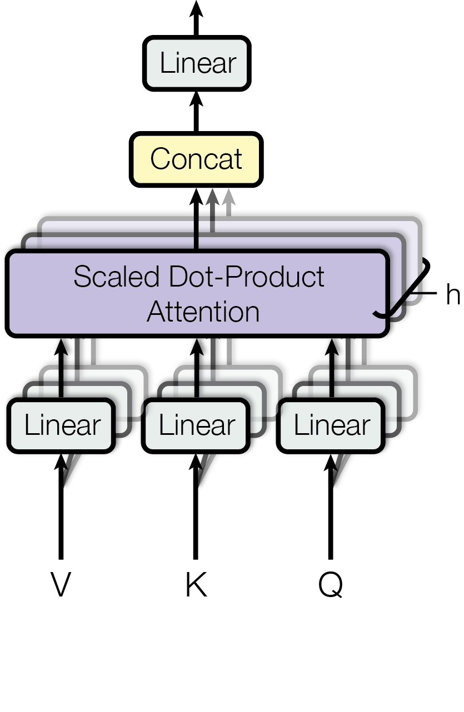
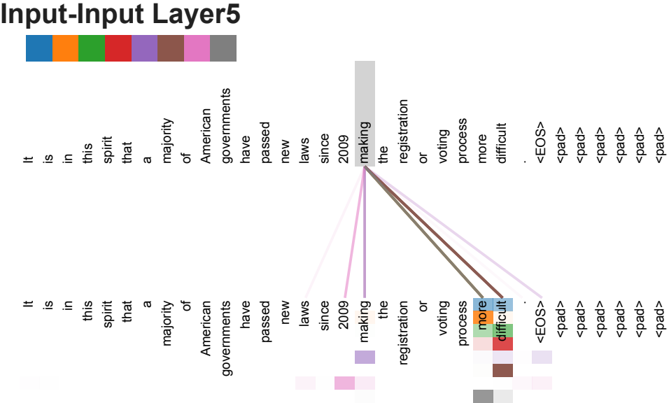
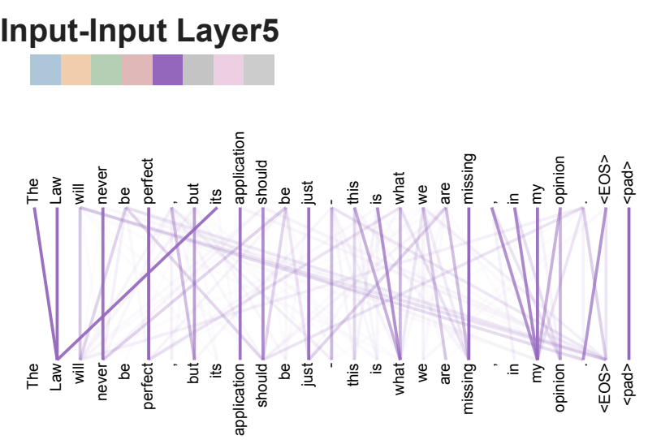
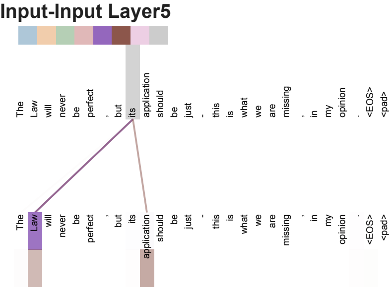
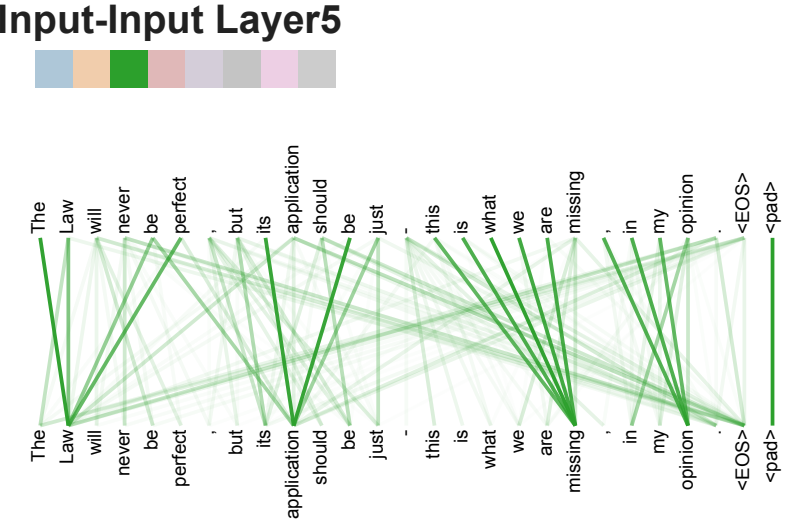
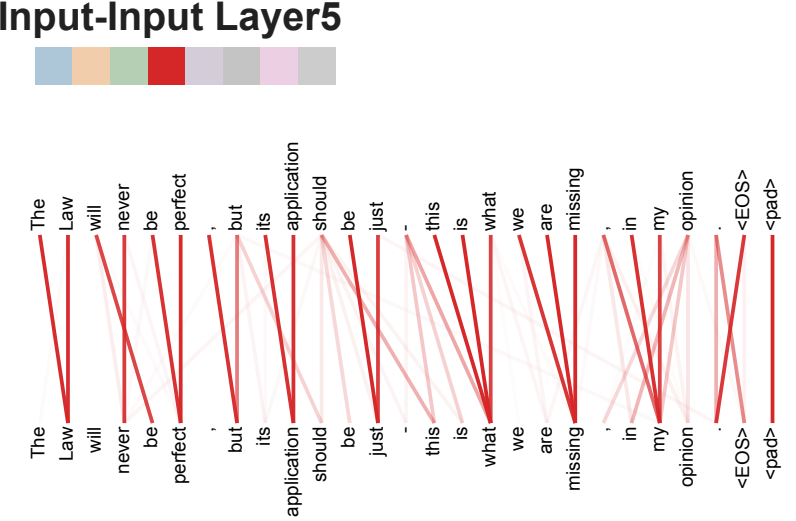

# Attention Is All You Need
# 注意力就是你所需要的一切

> Ashish Vaswani\*, Noam Shazeer\*, Niki Parmar\*, Jakob Uszkoreit\*, Llion Jones\*, Aidan N. Gomez\*†, Łukasz Kaiser\*, Illia Polosukhin\*‡

**作者**：Ashish Vaswani\*、Noam Shazeer\*、Niki Parmar\*、Jakob Uszkoreit\*、Llion Jones\*、Aidan N. Gomez\*†、Łukasz Kaiser\*、Illia Polosukhin\*‡

| 作者 | 单位 | 邮箱 |
| --- | --- | --- |
| Ashish Vaswani\* | Google Brain | avaswani@google.com |
| Noam Shazeer\* | Google Brain | noam@google.com |
| Niki Parmar\* | Google Research | nikip@google.com |
| Jakob Uszkoreit\* | Google Research | usz@google.com |
| Llion Jones\* | Google Research | llion@google.com |
| Aidan N. Gomez\*† | University of Toronto | aidan@cs.toronto.edu |
| Łukasz Kaiser\* | Google Brain | lukaszkaiser@google.com |
| Illia Polosukhin\*‡ | — | illia.polosukhin@gmail.com |

> \*Equal contribution. Listing order is random. Jakob proposed replacing RNNs with self-attention and started the effort to evaluate this idea. Ashish, with Illia, designed and implemented the first Transformer models and has been crucially involved in every aspect of this work. Noam proposed scaled dot-product attention, multi-head attention and the parameter-free position representation and became the other person involved in nearly every detail. Niki designed, implemented, tuned and evaluated countless model variants in our original codebase and tensor2tensor. Llion also experimented with novel model variants, was responsible for our initial codebase, and efficient inference and visualizations. Lukasz and Aidan spent countless long days designing various parts of and implementing tensor2tensor, replacing our earlier codebase, greatly improving results and massively accelerating our research.

\*同等贡献。署名顺序为随机排列。Jakob 提出用自注意力取代 RNN，并启动了评估这一想法的相关工作。Ashish 与 Illia 设计并实现了最初的 Transformer 模型，并深度参与了这项工作的每一个环节。Noam 提出了缩放点积注意力（scaled dot-product attention）、多头注意力（multi-head attention）以及无参数的位置表示，并成为几乎参与每个细节的另一位成员。Niki 在我们最初的代码库和 tensor2tensor 中设计、实现、调优并评估了无数模型变体。Llion 也试验了新颖的模型变体，负责我们最初的代码库，以及高效推理和可视化工作。Lukasz 和 Aidan 花了无数个漫长的日子设计并实现 tensor2tensor 的各个部分，用它替换了我们先前的代码库，大幅提升了结果，并极大地加速了我们的研究。

> †Work performed while at Google Brain.

†本工作是在 Google Brain 期间完成的。

> ‡Work performed while at Google Research.

‡本工作是在 Google Research 期间完成的。

> 31st Conference on Neural Information Processing Systems (NIPS 2017), Long Beach, CA, USA.

第 31 届神经信息处理系统大会（NIPS 2017），美国加州长滩。

> Provided proper attribution is provided, Google hereby grants permission to reproduce the tables and figures in this paper solely for use in journalistic or scholarly works.

在给予适当署名的前提下，Google 特此授予许可，允许仅为新闻报道或学术研究之目的复制本论文中的表格与插图。

---

## Abstract / 摘要

> The dominant sequence transduction models are based on complex recurrent or convolutional neural networks that include an encoder and a decoder. The best performing models also connect the encoder and decoder through an attention mechanism. We propose a new simple network architecture, the Transformer, based solely on attention mechanisms, dispensing with recurrence and convolutions entirely. Experiments on two machine translation tasks show these models to be superior in quality while being more parallelizable and requiring significantly less time to train. Our model achieves 28.4 BLEU on the WMT 2014 English-to-German translation task, improving over the existing best results, including ensembles, by over 2 BLEU. On the WMT 2014 English-to-French translation task, our model establishes a new single-model state-of-the-art BLEU score of 41.8 after training for 3.5 days on eight GPUs, a small fraction of the training costs of the best models from the literature. We show that the Transformer generalizes well to other tasks by applying it successfully to English constituency parsing both with large and limited training data.

主流的序列转导（sequence transduction）模型都建立在包含编码器和解码器的复杂循环神经网络或卷积神经网络之上。性能最好的模型还会通过注意力机制把编码器和解码器连接起来。我们提出了一种新的简单网络架构——Transformer，它完全基于注意力机制，彻底摒弃了循环与卷积。在两项机器翻译任务上的实验表明，这些模型在质量上更优，同时更易于并行化，而且训练所需的时间大幅减少。我们的模型在 WMT 2014 英德翻译任务上取得了 28.4 BLEU，比已有的最佳结果（包括集成模型）高出 2 BLEU 以上。在 WMT 2014 英法翻译任务上，我们的模型在 8 块 GPU 上训练 3.5 天之后，以单个模型创下了 41.8 BLEU 的新最优成绩，而这一训练成本仅是文献中最佳模型的一小部分。我们还将 Transformer 成功应用于英语成分句法分析（constituency parsing），无论训练数据充足还是有限都表现良好，从而说明它具有良好的泛化能力。

---

## 1 Introduction / 引言

> Recurrent neural networks, long short-term memory [13] and gated recurrent [7] neural networks in particular, have been firmly established as state of the art approaches in sequence modeling and transduction problems such as language modeling and machine translation [35, 2, 5]. Numerous efforts have since continued to push the boundaries of recurrent language models and encoder-decoder architectures [38, 24, 15].

循环神经网络，尤其是长短期记忆网络（long short-term memory, LSTM）[13] 和门控循环神经网络（gated recurrent neural network）[7]，已被牢固确立为序列建模与转导问题（如语言建模和机器翻译）中的最优方法 [35, 2, 5]。此后，大量工作不断拓展循环语言模型和编码器-解码器架构的边界 [38, 24, 15]。

> Recurrent models typically factor computation along the symbol positions of the input and output sequences. Aligning the positions to steps in computation time, they generate a sequence of hidden states $h_t$, as a function of the previous hidden state $h_{t-1}$ and the input for position $t$. This inherently sequential nature precludes parallelization within training examples, which becomes critical at longer sequence lengths, as memory constraints limit batching across examples. Recent work has achieved significant improvements in computational efficiency through factorization tricks [21] and conditional computation [32], while also improving model performance in case of the latter. The fundamental constraint of sequential computation, however, remains.

循环模型通常沿输入和输出序列的符号位置来分解计算。它们把位置与计算时间中的步对齐，生成一系列隐藏状态 $h_t$，其中 $h_t$ 是前一个隐藏状态 $h_{t-1}$ 和位置 $t$ 处输入的函数。这种固有的序列性使得训练样本内部无法并行化；而在序列较长时这一问题尤为关键，因为内存限制会制约跨样本的批处理。近期的工作通过分解技巧（factorization tricks）[21] 和条件计算（conditional computation）[32] 在计算效率上取得了显著提升，其中后者还同时改善了模型性能。然而，顺序计算这一根本性约束依然存在。

> Attention mechanisms have become an integral part of compelling sequence modeling and transduction models in various tasks, allowing modeling of dependencies without regard to their distance in the input or output sequences [2, 19]. In all but a few cases [27], however, such attention mechanisms are used in conjunction with a recurrent network.

注意力机制已成为各种任务中出色的序列建模与转导模型不可或缺的一部分，它使得建模依赖关系时无需考虑这些依赖在输入或输出序列中的距离 [2, 19]。然而，除了少数情况 [27] 之外，这类注意力机制都是与循环网络结合使用的。

> In this work we propose the Transformer, a model architecture eschewing recurrence and instead relying entirely on an attention mechanism to draw global dependencies between input and output. The Transformer allows for significantly more parallelization and can reach a new state of the art in translation quality after being trained for as little as twelve hours on eight P100 GPUs.

在这项工作中，我们提出了 Transformer：一种避开循环、转而完全依靠注意力机制来刻画输入与输出之间全局依赖关系的模型架构。Transformer 支持显著更多的并行化，并且在 8 块 P100 GPU 上仅训练十二个小时，就能达到翻译质量的新最优水平。

---

## 2 Background / 背景

> The goal of reducing sequential computation also forms the foundation of the Extended Neural GPU [16], ByteNet [18] and ConvS2S [9], all of which use convolutional neural networks as basic building block, computing hidden representations in parallel for all input and output positions. In these models, the number of operations required to relate signals from two arbitrary input or output positions grows in the distance between positions, linearly for ConvS2S and logarithmically for ByteNet. This makes it more difficult to learn dependencies between distant positions [12]. In the Transformer this is reduced to a constant number of operations, albeit at the cost of reduced effective resolution due to averaging attention-weighted positions, an effect we counteract with Multi-Head Attention as described in section 3.2.

减少顺序计算这一目标，同样也是 Extended Neural GPU [16]、ByteNet [18] 和 ConvS2S [9] 的基础。这些模型都以卷积神经网络作为基本构建模块，为所有输入和输出位置并行地计算隐藏表示。在这些模型中，关联任意两个输入或输出位置信号所需的操作数，会随位置间距离的增长而增长：对 ConvS2S 是线性的，对 ByteNet 是对数的。这使得学习相距较远位置之间的依赖关系变得更加困难 [12]。在 Transformer 中，这一点被缩减为常数级的操作数，但代价是由于对注意力加权位置取平均而导致的"有效分辨率"下降；我们通过第 3.2 节所述的多头注意力来抵消这一影响。

> Self-attention, sometimes called intra-attention is an attention mechanism relating different positions of a single sequence in order to compute a representation of the sequence. Self-attention has been used successfully in a variety of tasks including reading comprehension, abstractive summarization, textual entailment and learning task-independent sentence representations [4, 27, 28, 22].

自注意力（self-attention），有时也被称为内部注意力（intra-attention），是一种把单个序列中不同位置相互关联、以计算该序列表示的注意力机制。自注意力已在多种任务中被成功使用，包括阅读理解、抽象式摘要、文本蕴含，以及学习与任务无关的句子表示 [4, 27, 28, 22]。

> End-to-end memory networks are based on a recurrent attention mechanism instead of sequence-aligned recurrence and have been shown to perform well on simple-language question answering and language modeling tasks [34].

端到端记忆网络（end-to-end memory network）基于循环注意力机制而非按序列对齐的循环，已被证明在简单语言问答和语言建模任务上表现良好 [34]。

> To the best of our knowledge, however, the Transformer is the first transduction model relying entirely on self-attention to compute representations of its input and output without using sequence-aligned RNNs or convolution. In the following sections, we will describe the Transformer, motivate self-attention and discuss its advantages over models such as [17, 18] and [9].

然而据我们所知，Transformer 是第一个完全依靠自注意力来计算其输入和输出表示、而不使用按序列对齐的 RNN 或卷积的转导模型。在接下来的几节中，我们将描述 Transformer，论证采用自注意力的理由，并讨论它相对于 [17, 18] 和 [9] 等模型的优势。

---

## 3 Model Architecture / 模型架构

> **Figure 1: The Transformer - model architecture.**

**图 1：Transformer —— 模型架构。**

> Most competitive neural sequence transduction models have an encoder-decoder structure [5, 2, 35]. Here, the encoder maps an input sequence of symbol representations $(x_1, ..., x_n)$ to a sequence of continuous representations $\mathbf{z} = (z_1, ..., z_n)$. Given $\mathbf{z}$, the decoder then generates an output sequence $(y_1, ..., y_m)$ of symbols one element at a time. At each step the model is auto-regressive [10], consuming the previously generated symbols as additional input when generating the next.

大多数有竞争力的神经序列转导模型都采用编码器-解码器结构 [5, 2, 35]。在这里，编码器把输入的符号表示序列 $(x_1, ..., x_n)$ 映射为连续表示序列 $\mathbf{z} = (z_1, ..., z_n)$。给定 $\mathbf{z}$ 之后，解码器便逐个元素地生成输出符号序列 $(y_1, ..., y_m)$。每一步中，模型都是自回归的（auto-regressive）[10]，即在生成下一个符号时，会把先前已生成的符号作为额外输入一并使用。

> The Transformer follows this overall architecture using stacked self-attention and point-wise, fully connected layers for both the encoder and decoder, shown in the left and right halves of Figure 1, respectively.

Transformer 沿用这一总体架构，在编码器和解码器中都使用堆叠的自注意力层和逐位置的全连接层，分别如图 1 的左半部分和右半部分所示。

### 3.1 Encoder and Decoder Stacks / 编码器与解码器堆叠

> **Encoder:** The encoder is composed of a stack of $N = 6$ identical layers. Each layer has two sub-layers. The first is a multi-head self-attention mechanism, and the second is a simple, position-wise fully connected feed-forward network. We employ a residual connection [11] around each of the two sub-layers, followed by layer normalization [1]. That is, the output of each sub-layer is $\mathrm{LayerNorm}(x + \mathrm{Sublayer}(x))$, where $\mathrm{Sublayer}(x)$ is the function implemented by the sub-layer itself. To facilitate these residual connections, all sub-layers in the model, as well as the embedding layers, produce outputs of dimension $d_{\text{model}} = 512$.

**编码器：** 编码器由 $N = 6$ 个完全相同的层堆叠而成。每一层包含两个子层。第一个是多头自注意力机制，第二个是简单的逐位置全连接前馈网络。我们在这两个子层周围各使用一个残差连接（residual connection）[11]，随后进行层归一化（layer normalization）[1]。也就是说，每个子层的输出为 $\mathrm{LayerNorm}(x + \mathrm{Sublayer}(x))$，其中 $\mathrm{Sublayer}(x)$ 是该子层自身所实现的函数。为便于这些残差连接，模型中所有子层以及嵌入层产生的输出维度均为 $d_{\text{model}} = 512$。

> **Decoder:** The decoder is also composed of a stack of $N = 6$ identical layers. In addition to the two sub-layers in each encoder layer, the decoder inserts a third sub-layer, which performs multi-head attention over the output of the encoder stack. Similar to the encoder, we employ residual connections around each of the sub-layers, followed by layer normalization. We also modify the self-attention sub-layer in the decoder stack to prevent positions from attending to subsequent positions. This masking, combined with fact that the output embeddings are offset by one position, ensures that the predictions for position $i$ can depend only on the known outputs at positions less than $i$.

**解码器：** 解码器同样由 $N = 6$ 个完全相同的层堆叠而成。除编码器每层中的两个子层之外，解码器还插入了第三个子层，它对编码器堆叠的输出执行多头注意力。与编码器类似，我们在每个子层周围使用残差连接，随后进行层归一化。我们还修改了解码器堆叠中的自注意力子层，以阻止某个位置注意到其后的位置。这种掩蔽（masking），再加上输出嵌入被偏移一个位置这一事实，共同保证了对位置 $i$ 的预测只能依赖于位置小于 $i$ 的已知输出。

### 3.2 Attention / 注意力

> An attention function can be described as mapping a query and a set of key-value pairs to an output, where the query, keys, values, and output are all vectors. The output is computed as a weighted sum of the values, where the weight assigned to each value is computed by a compatibility function of the query with the corresponding key.

注意力函数可以描述为：把一个查询（query）和一组键-值对（key-value pair）映射为一个输出，其中查询、键、值和输出都是向量。输出被计算为值的加权和，而分配给每个值的权重，则由查询与对应键之间的一个相容性函数（compatibility function）计算得到。

#### 3.2.1 Scaled Dot-Product Attention / 缩放点积注意力

> We call our particular attention "Scaled Dot-Product Attention" (Figure 2). The input consists of queries and keys of dimension $d_k$, and values of dimension $d_v$. We compute the dot products of the query with all keys, divide each by $\sqrt{d_k}$, and apply a softmax function to obtain the weights on the values.

我们把所采用的这种注意力称为"缩放点积注意力"（Scaled Dot-Product Attention，图 2）。其输入由维度为 $d_k$ 的查询和键，以及维度为 $d_v$ 的值组成。我们计算查询与所有键的点积，将每个点积除以 $\sqrt{d_k}$，然后施加 softmax 函数，以得到作用于值的权重。

> In practice, we compute the attention function on a set of queries simultaneously, packed together into a matrix $Q$. The keys and values are also packed together into matrices $K$ and $V$. We compute the matrix of outputs as:

在实践中，我们同时对一组查询计算注意力函数，把它们打包成一个矩阵 $Q$。键和值也分别打包成矩阵 $K$ 和 $V$。我们按下式计算输出的矩阵：

$$\mathrm{Attention}(Q, K, V) = \mathrm{softmax}\left(\frac{QK^T}{\sqrt{d_k}}\right)V \tag{1}$$

> The two most commonly used attention functions are additive attention [2], and dot-product (multiplicative) attention. Dot-product attention is identical to our algorithm, except for the scaling factor of $\frac{1}{\sqrt{d_k}}$. Additive attention computes the compatibility function using a feed-forward network with a single hidden layer. While the two are similar in theoretical complexity, dot-product attention is much faster and more space-efficient in practice, since it can be implemented using highly optimized matrix multiplication code.

最常用的两种注意力函数是加性注意力（additive attention）[2] 和点积（乘性）注意力。除缩放因子 $\frac{1}{\sqrt{d_k}}$ 之外，点积注意力与我们的算法完全相同。加性注意力使用一个带单隐藏层的前馈网络来计算相容性函数。尽管两者在理论复杂度上相近，但在实践中点积注意力要快得多，也更节省空间，因为它可以用高度优化的矩阵乘法代码来实现。

> While for small values of $d_k$ the two mechanisms perform similarly, additive attention outperforms dot product attention without scaling for larger values of $d_k$ [3]. We suspect that for large values of $d_k$, the dot products grow large in magnitude, pushing the softmax function into regions where it has extremely small gradients $^4$. To counteract this effect, we scale the dot products by $\frac{1}{\sqrt{d_k}}$.

当 $d_k$ 取值较小时，两种机制的表现相近；而当 $d_k$ 较大时，若不进行缩放，加性注意力的表现会优于点积注意力 [3]。我们推测，当 $d_k$ 较大时，点积的数值会变得很大，从而把 softmax 函数推入其梯度极小的区域 $^4$。为抵消这一影响，我们用 $\frac{1}{\sqrt{d_k}}$ 对点积进行缩放。

> $^4$ To illustrate why the dot products get large, assume that the components of $q$ and $k$ are independent random variables with mean $0$ and variance $1$. Then their dot product, $q \cdot k = \sum_{i=1}^{d_k} q_i k_i$, has mean $0$ and variance $d_k$.

$^4$ 为说明点积为何会变大，假设 $q$ 和 $k$ 的各分量是均值为 $0$、方差为 $1$ 的相互独立随机变量。那么它们的点积 $q \cdot k = \sum_{i=1}^{d_k} q_i k_i$ 的均值为 $0$、方差为 $d_k$。

#### 3.2.2 Multi-Head Attention / 多头注意力

> **Figure 2: (left) Scaled Dot-Product Attention. (right) Multi-Head Attention consists of several attention layers running in parallel.**

**图 2：（左）缩放点积注意力。（右）多头注意力由若干个并行运行的注意力层组成。**

> Instead of performing a single attention function with $d_{\text{model}}$-dimensional keys, values and queries, we found it beneficial to linearly project the queries, keys and values $h$ times with different, learned linear projections to $d_k$, $d_k$ and $d_v$ dimensions, respectively. On each of these projected versions of queries, keys and values we then perform the attention function in parallel, yielding $d_v$-dimensional output values. These are concatenated and once again projected, resulting in the final values, as depicted in Figure 2.

与使用 $d_{\text{model}}$ 维的键、值和查询执行单个注意力函数不同，我们发现更有利的做法是：用 $h$ 组不同的、可学习的线性投影，分别把查询、键和值线性投影到 $d_k$、$d_k$ 和 $d_v$ 维。然后，我们在这些投影后的查询、键和值上并行地执行注意力函数，得到 $d_v$ 维的输出值。这些输出值被拼接起来并再次投影，从而得到最终的值，如图 2 所示。

> Multi-head attention allows the model to jointly attend to information from different representation subspaces at different positions. With a single attention head, averaging inhibits this.

多头注意力允许模型在不同位置同时关注来自不同表示子空间的信息。若只有一个注意力头，取平均会抑制这一点。

$$\mathrm{MultiHead}(Q, K, V) = \mathrm{Concat}(\mathrm{head}_1, ..., \mathrm{head}_h)W^O$$

$$\text{其中 } \mathrm{head}_i = \mathrm{Attention}(QW_i^Q, KW_i^K, VW_i^V)$$

> Where the projections are parameter matrices $W_i^Q \in \mathbb{R}^{d_{\text{model}} \times d_k}$, $W_i^K \in \mathbb{R}^{d_{\text{model}} \times d_k}$, $W_i^V \in \mathbb{R}^{d_{\text{model}} \times d_v}$ and $W^O \in \mathbb{R}^{hd_v \times d_{\text{model}}}$.

其中，投影为参数矩阵 $W_i^Q \in \mathbb{R}^{d_{\text{model}} \times d_k}$、$W_i^K \in \mathbb{R}^{d_{\text{model}} \times d_k}$、$W_i^V \in \mathbb{R}^{d_{\text{model}} \times d_v}$ 以及 $W^O \in \mathbb{R}^{hd_v \times d_{\text{model}}}$。

> In this work we employ $h = 8$ parallel attention layers, or heads. For each of these we use $d_k = d_v = d_{\text{model}}/h = 64$. Due to the reduced dimension of each head, the total computational cost is similar to that of single-head attention with full dimensionality.

在这项工作中，我们采用 $h = 8$ 个并行的注意力层，也就是 8 个头。对每个头，我们取 $d_k = d_v = d_{\text{model}}/h = 64$。由于每个头的维度降低，总计算成本与使用完整维度的单头注意力相近。

#### 3.2.3 Applications of Attention in our Model / 注意力在我们模型中的应用

> The Transformer uses multi-head attention in three different ways:

Transformer 以三种不同的方式使用多头注意力：

> - In "encoder-decoder attention" layers, the queries come from the previous decoder layer, and the memory keys and values come from the output of the encoder. This allows every position in the decoder to attend over all positions in the input sequence. This mimics the typical encoder-decoder attention mechanisms in sequence-to-sequence models such as [38, 2, 9].

- 在"编码器-解码器注意力"层中，查询来自前一个解码器层，而记忆的键和值来自编码器的输出。这使得解码器中的每个位置都能注意到输入序列中的所有位置。这模拟了 [38, 2, 9] 等序列到序列模型中典型的编码器-解码器注意力机制。

> - The encoder contains self-attention layers. In a self-attention layer all of the keys, values and queries come from the same place, in this case, the output of the previous layer in the encoder. Each position in the encoder can attend to all positions in the previous layer of the encoder.

- 编码器包含自注意力层。在自注意力层中，所有的键、值和查询都来自同一个地方，在这里即编码器中前一层的输出。编码器中的每个位置都可以注意到编码器前一层的所有位置。

> - Similarly, self-attention layers in the decoder allow each position in the decoder to attend to all positions in the decoder up to and including that position. We need to prevent leftward information flow in the decoder to preserve the auto-regressive property. We implement this inside of scaled dot-product attention by masking out (setting to $-\infty$) all values in the input of the softmax which correspond to illegal connections. See Figure 2.

- 类似地，解码器中的自注意力层允许解码器中的每个位置注意到解码器中直到并包括该位置在内的所有位置。我们需要阻止解码器中的信息向左流动，以保持自回归性质。我们在缩放点积注意力内部实现这一点：把 softmax 输入中所有对应非法连接的值掩蔽掉（设为 $-\infty$）。见图 2。

### 3.3 Position-wise Feed-Forward Networks / 逐位置前馈网络

> In addition to attention sub-layers, each of the layers in our encoder and decoder contains a fully connected feed-forward network, which is applied to each position separately and identically. This consists of two linear transformations with a ReLU activation in between.

除注意力子层之外，我们编码器和解码器中的每一层还包含一个全连接前馈网络，它被分别且同等地应用于每个位置。该网络由两次线性变换构成，中间夹着一个 ReLU 激活函数。

$$\mathrm{FFN}(x)=\max(0, xW_1 + b_1)W_2 + b_2 \tag{2}$$

> While the linear transformations are the same across different positions, they use different parameters from layer to layer. Another way of describing this is as two convolutions with kernel size 1. The dimensionality of input and output is $d_{\text{model}} = 512$, and the inner-layer has dimensionality $d_{ff} = 2048$.

尽管这些线性变换在不同位置之间是相同的，但它们在层与层之间使用不同的参数。另一种描述方式是：把它看作两个卷积核大小为 1 的卷积。输入和输出的维度是 $d_{\text{model}} = 512$，内层的维度是 $d_{ff} = 2048$。

### 3.4 Embeddings and Softmax / 嵌入与 Softmax

> Similarly to other sequence transduction models, we use learned embeddings to convert the input tokens and output tokens to vectors of dimension $d_{\text{model}}$. We also use the usual learned linear transformation and softmax function to convert the decoder output to predicted next-token probabilities. In our model, we share the same weight matrix between the two embedding layers and the pre-softmax linear transformation, similar to [30]. In the embedding layers, we multiply those weights by $\sqrt{d_{\text{model}}}$.

与其他序列转导模型类似，我们使用可学习的嵌入把输入词元（token）和输出词元转换为维度为 $d_{\text{model}}$ 的向量。我们还使用通常的可学习线性变换和 softmax 函数，把解码器的输出转换为对下一个词元的预测概率。在我们的模型中，两个嵌入层与 softmax 之前的线性变换共享同一个权重矩阵，这与 [30] 类似。在嵌入层中，我们将这些权重乘以 $\sqrt{d_{\text{model}}}$。

### 3.5 Positional Encoding / 位置编码

> Since our model contains no recurrence and no convolution, in order for the model to make use of the order of the sequence, we must inject some information about the relative or absolute position of the tokens in the sequence. To this end, we add "positional encodings" to the input embeddings at the bottoms of the encoder and decoder stacks. The positional encodings have the same dimension $d_{\text{model}}$ as the embeddings, so that the two can be summed. There are many choices of positional encodings, learned and fixed [9].

由于我们的模型既不包含循环也不包含卷积，为了让模型能够利用序列的顺序，我们必须注入一些关于词元在序列中相对或绝对位置的信息。为此，我们在编码器和解码器堆叠底部的输入嵌入上加上"位置编码"（positional encoding）。位置编码与嵌入具有相同的维度 $d_{\text{model}}$，因此二者可以直接相加。位置编码有多种选择，既可以是可学习的，也可以是固定的 [9]。

> In this work, we use sine and cosine functions of different frequencies:

在这项工作中，我们使用不同频率的正弦和余弦函数：

$$PE_{(pos,2i)} = \sin\left(pos / 10000^{2i/d_{\text{model}}}\right)$$

$$PE_{(pos,2i+1)} = \cos\left(pos / 10000^{2i/d_{\text{model}}}\right)$$

> where $pos$ is the position and $i$ is the dimension. That is, each dimension of the positional encoding corresponds to a sinusoid. The wavelengths form a geometric progression from $2\pi$ to $10000 \cdot 2\pi$. We chose this function because we hypothesized it would allow the model to easily learn to attend by relative positions, since for any fixed offset $k$, $PE_{pos+k}$ can be represented as a linear function of $PE_{pos}$.

其中 $pos$ 是位置，$i$ 是维度。也就是说，位置编码的每个维度都对应一条正弦曲线。其波长构成一个从 $2\pi$ 到 $10000 \cdot 2\pi$ 的等比数列。我们选择这个函数，是因为我们假设它能让模型容易地学会按相对位置进行注意：对于任意固定的偏移量 $k$，$PE_{pos+k}$ 都可以表示为 $PE_{pos}$ 的线性函数。

> We also experimented with using learned positional embeddings [9] instead, and found that the two versions produced nearly identical results (see Table 3 row (E)). We chose the sinusoidal version because it may allow the model to extrapolate to sequence lengths longer than the ones encountered during training.

我们也试验了改用可学习的位置嵌入 [9]，结果发现两种版本产生的结果几乎完全相同（见表 3 第 (E) 行）。我们选择了正弦版本，因为它可能允许模型外推到比训练时遇到的更长的序列长度。

---

## 4 Why Self-Attention / 为什么使用自注意力

> In this section we compare various aspects of self-attention layers to the recurrent and convolutional layers commonly used for mapping one variable-length sequence of symbol representations $(x_1, ..., x_n)$ to another sequence of equal length $(z_1, ..., z_n)$, with $x_i, z_i \in \mathbb{R}^d$, such as a hidden layer in a typical sequence transduction encoder or decoder. Motivating our use of self-attention we consider three desiderata.

在本节中，我们把自注意力层与常用的循环层和卷积层进行比较。这些层用于把一个变长的符号表示序列 $(x_1, ..., x_n)$ 映射为另一个等长的序列 $(z_1, ..., z_n)$，其中 $x_i, z_i \in \mathbb{R}^d$，例如典型序列转导编码器或解码器中的某个隐藏层。为论证我们采用自注意力的理由，我们考虑三个 desiderata（期望目标）。

> One is the total computational complexity per layer. Another is the amount of computation that can be parallelized, as measured by the minimum number of sequential operations required.

其一是每层的总计算复杂度。其二是可以并行化的计算量，以所需的最少顺序操作数来衡量。

> The third is the path length between long-range dependencies in the network. Learning long-range dependencies is a key challenge in many sequence transduction tasks. One key factor affecting the ability to learn such dependencies is the length of the paths forward and backward signals have to traverse in the network. The shorter these paths between any combination of positions in the input and output sequences, the easier it is to learn long-range dependencies [12]. Hence we also compare the maximum path length between any two input and output positions in networks composed of the different layer types.

其三是网络中长程依赖之间的路径长度。学习长程依赖是许多序列转导任务中的关键挑战。影响学习此类依赖能力的一个关键因素，是前向信号和反向信号在网络中必须穿行的路径长度。输入和输出序列中任意位置组合之间的这些路径越短，就越容易学习长程依赖 [12]。因此，我们还比较了由不同层类型构成的网络中，任意两个输入和输出位置之间的最大路径长度。

> Table 1: Maximum path lengths, per-layer complexity and minimum number of sequential operations for different layer types. $n$ is the sequence length, $d$ is the representation dimension, $k$ is the kernel size of convolutions and $r$ the size of the neighborhood in restricted self-attention.

表 1：不同层类型的最大路径长度、每层复杂度和最少顺序操作数。$n$ 是序列长度，$d$ 是表示维度，$k$ 是卷积核大小，$r$ 是受限自注意力中邻域的大小。

**Table 1 / 表 1**

| Layer Type / 层类型 | Complexity per Layer / 每层复杂度 | Sequential Operations / 顺序操作数 | Maximum Path Length / 最大路径长度 |
| --- | --- | --- | --- |
| Self-Attention / 自注意力 | $O(n^2 \cdot d)$ | $O(1)$ | $O(1)$ |
| Recurrent / 循环 | $O(n \cdot d^2)$ | $O(n)$ | $O(n)$ |
| Convolutional / 卷积 | $O(k \cdot n \cdot d^2)$ | $O(1)$ | $O(\log_k(n))$ |
| Self-Attention (restricted) / 自注意力（受限） | $O(r \cdot n \cdot d)$ | $O(1)$ | $O(n/r)$ |

> As noted in Table 1, a self-attention layer connects all positions with a constant number of sequentially executed operations, whereas a recurrent layer requires $O(n)$ sequential operations. In terms of computational complexity, self-attention layers are faster than recurrent layers when the sequence length $n$ is smaller than the representation dimensionality $d$, which is most often the case with sentence representations used by state-of-the-art models in machine translations, such as word-piece [38] and byte-pair [31] representations. To improve computational performance for tasks involving very long sequences, self-attention could be restricted to considering only a neighborhood of size $r$ in the input sequence centered around the respective output position. This would increase the maximum path length to $O(n/r)$. We plan to investigate this approach further in future work.

如表 1 所示，自注意力层用常数个顺序执行的操作连接所有位置，而循环层需要 $O(n)$ 个顺序操作。就计算复杂度而言，当序列长度 $n$ 小于表示维度 $d$ 时，自注意力层比循环层更快；而在机器翻译中最先进模型所使用的句子表示（如 word-piece [38] 和 byte-pair [31] 表示）中，这种情况最为常见。为提升涉及超长序列的任务的计算性能，可以把自注意力限制为只考虑输入序列中以相应输出位置为中心、大小为 $r$ 的邻域。这会把最大路径长度增加到 $O(n/r)$。我们计划在未来的工作中进一步研究这种方法。

> A single convolutional layer with kernel width $k < n$ does not connect all pairs of input and output positions. Doing so requires a stack of $O(n/k)$ convolutional layers in the case of contiguous kernels, or $O(\log_k(n))$ in the case of dilated convolutions [18], increasing the length of the longest paths between any two positions in the network. Convolutional layers are generally more expensive than recurrent layers, by a factor of $k$. Separable convolutions [6], however, decrease the complexity considerably, to $O(k \cdot n \cdot d + n \cdot d^2)$. Even with $k = n$, however, the complexity of a separable convolution is equal to the combination of a self-attention layer and a point-wise feed-forward layer, the approach we take in our model.

当卷积核宽度 $k < n$ 时，单个卷积层无法连接所有输入和输出位置对。要做到这一点，在连续卷积核的情况下需要堆叠 $O(n/k)$ 个卷积层，在空洞卷积（dilated convolution）的情况下需要 $O(\log_k(n))$ 个 [18]，这就增加了网络中任意两个位置之间最长路径的长度。卷积层通常比循环层更昂贵，代价是 $k$ 倍。然而，可分离卷积（separable convolution）[6] 可以把复杂度大幅降低到 $O(k \cdot n \cdot d + n \cdot d^2)$。不过，即使 $k = n$，可分离卷积的复杂度也等于一个自注意力层与一个逐位置前馈层的组合，而这正是我们模型所采用的做法。

> As side benefit, self-attention could yield more interpretable models. We inspect attention distributions from our models and present and discuss examples in the appendix. Not only do individual attention heads clearly learn to perform different tasks, many appear to exhibit behavior related to the syntactic and semantic structure of the sentences.

作为附带的好处，自注意力还能带来可解释性更强的模型。我们检查了模型中的注意力分布，并在附录中给出并讨论了若干例子。各个注意力头不仅明显学会了执行不同的任务，其中许多还表现出与句子的句法和语义结构相关的行为。

---

## 5 Training / 训练

> This section describes the training regime for our models.

本节描述我们模型的训练方案。

### 5.1 Training Data and Batching / 训练数据与批处理

> We trained on the standard WMT 2014 English-German dataset consisting of about 4.5 million sentence pairs. Sentences were encoded using byte-pair encoding [3], which has a shared source-target vocabulary of about 37000 tokens. For English-French, we used the significantly larger WMT 2014 English-French dataset consisting of 36M sentences and split tokens into a 32000 word-piece vocabulary [38]. Sentence pairs were batched together by approximate sequence length. Each training batch contained a set of sentence pairs containing approximately 25000 source tokens and 25000 target tokens.

我们在标准的 WMT 2014 英德数据集上训练，该数据集包含约 450 万个句子对。句子使用字节对编码（byte-pair encoding）[3] 进行编码，其源语言与目标语言共享约 37000 个词元的词表。对于英法任务，我们使用了规模大得多的 WMT 2014 英法数据集，包含 3600 万个句子，并把词元切分为 32000 个 word-piece 词元构成的词表 [38]。句子对按近似序列长度进行批处理。每个训练批次包含一组句子对，其中大约有 25000 个源语言词元和 25000 个目标语言词元。

### 5.2 Hardware and Schedule / 硬件与训练时间安排

> We trained our models on one machine with 8 NVIDIA P100 GPUs. For our base models using the hyperparameters described throughout the paper, each training step took about 0.4 seconds. We trained the base models for a total of 100,000 steps or 12 hours. For our big models, (described on the bottom line of table 3), step time was 1.0 seconds. The big models were trained for 300,000 steps (3.5 days).

我们在一台配备 8 块 NVIDIA P100 GPU 的机器上训练模型。对于使用本文所述超参数的 base 模型，每个训练步耗时约 0.4 秒。base 模型总共训练了 100,000 步，即 12 小时。对于 big 模型（见表 3 最后一行），每步耗时 1.0 秒。big 模型训练了 300,000 步（3.5 天）。

### 5.3 Optimizer / 优化器

> We used the Adam optimizer [20] with $\beta_1 = 0.9$, $\beta_2 = 0.98$ and $\epsilon = 10^{-9}$. We varied the learning rate over the course of training, according to the formula:

我们使用 Adam 优化器 [20]，取 $\beta_1 = 0.9$、$\beta_2 = 0.98$、$\epsilon = 10^{-9}$。在训练过程中，我们按以下公式改变学习率：

$$lrate = d_{\text{model}}^{-0.5} \cdot \min\left(step\_num^{-0.5},\ step\_num \cdot warmup\_steps^{-1.5}\right) \tag{3}$$

> This corresponds to increasing the learning rate linearly for the first $warmup\_steps$ training steps, and decreasing it thereafter proportionally to the inverse square root of the step number. We used $warmup\_steps = 4000$.

这相当于在最初的 $warmup\_steps$ 个训练步中线性地增大学习率，此后则按步数的平方根反比减小学习率。我们取 $warmup\_steps = 4000$。

### 5.4 Regularization / 正则化

> We employ three types of regularization during training:

我们在训练期间采用三种正则化手段：

> **Residual Dropout** We apply dropout [33] to the output of each sub-layer, before it is added to the sub-layer input and normalized. In addition, we apply dropout to the sums of the embeddings and the positional encodings in both the encoder and decoder stacks. For the base model, we use a rate of $P_{drop} = 0.1$.

**残差 Dropout** 我们对每个子层的输出施加 dropout [33]，施加位置是在它被加到子层输入并归一化之前。此外，我们对编码器和解码器堆叠中嵌入与位置编码之和也施加 dropout。对 base 模型，我们使用的比例为 $P_{drop} = 0.1$。

> **Label Smoothing** During training, we employed label smoothing of value $\epsilon_{ls} = 0.1$ [36]. This hurts perplexity, as the model learns to be more unsure, but improves accuracy and BLEU score.

**标签平滑** 在训练期间，我们采用值为 $\epsilon_{ls} = 0.1$ 的标签平滑（label smoothing）[36]。这会损害困惑度（perplexity），因为模型学会了更加不确定，但它提高了准确率和 BLEU 分数。

---

## 6 Results / 结果

### 6.1 Machine Translation / 机器翻译

> Table 2: The Transformer achieves better BLEU scores than previous state-of-the-art models on the English-to-German and English-to-French newstest2014 tests at a fraction of the training cost.

表 2：在英德和英法 newstest2014 测试集上，Transformer 以仅为前者零头的训练成本取得了比先前最先进模型更好的 BLEU 分数。

**Table 2 / 表 2**

| Model / 模型 | BLEU EN-DE | BLEU EN-FR | Training Cost (FLOPs) EN-DE | Training Cost (FLOPs) EN-FR |
| --- | --- | --- | --- | --- |
| ByteNet [18] | 23.75 | — | — | — |
| Deep-Att + PosUnk [39] | — | 39.2 | — | $1.0 \cdot 10^{20}$ |
| GNMT + RL [38] | 24.6 | 39.92 | $2.3 \cdot 10^{19}$ | $1.4 \cdot 10^{20}$ |
| ConvS2S [9] | 25.16 | 40.46 | $9.6 \cdot 10^{18}$ | $1.5 \cdot 10^{20}$ |
| MoE [32] | 26.03 | 40.56 | $2.0 \cdot 10^{19}$ | $1.2 \cdot 10^{20}$ |
| Deep-Att + PosUnk Ensemble [39] | — | 40.4 | — | $8.0 \cdot 10^{20}$ |
| GNMT + RL Ensemble [38] | 26.30 | 41.16 | $1.8 \cdot 10^{20}$ | $1.1 \cdot 10^{21}$ |
| ConvS2S Ensemble [9] | 26.36 | **41.29** | $7.7 \cdot 10^{19}$ | $1.2 \cdot 10^{21}$ |
| Transformer (base model) | 27.3 | 38.1 | $\mathbf{3.3 \cdot 10^{18}}$ | $\mathbf{3.3 \cdot 10^{18}}$ |
| Transformer (big) | **28.4** | **41.8** | $2.3 \cdot 10^{19}$ | $2.3 \cdot 10^{19}$ |

> On the WMT 2014 English-to-German translation task, the big transformer model (Transformer (big) in Table 2) outperforms the best previously reported models (including ensembles) by more than 2.0 BLEU, establishing a new state-of-the-art BLEU score of 28.4. The configuration of this model is listed in the bottom line of Table 3. Training took 3.5 days on 8 P100 GPUs. Even our base model surpasses all previously published models and ensembles, at a fraction of the training cost of any of the competitive models.

在 WMT 2014 英德翻译任务上，big transformer 模型（表 2 中的 Transformer (big)）比先前报告的最佳模型（包括集成模型）高出 2.0 BLEU 以上，创下了 28.4 的新最优 BLEU 分数。该模型的配置列于表 3 的最后一行。训练在 8 块 P100 GPU 上耗时 3.5 天。即便是我们的 base 模型，也以仅为任何竞争模型零头的训练成本，超越了先前发表的所有模型和集成模型。

> On the WMT 2014 English-to-French translation task, our big model achieves a BLEU score of 41.0, outperforming all of the previously published single models, at less than 1/4 the training cost of the previous state-of-the-art model. The Transformer (big) model trained for English-to-French used dropout rate $P_{drop} = 0.1$, instead of 0.3.

在 WMT 2014 英法翻译任务上，我们的 big 模型取得了 41.0 的 BLEU 分数，超越了先前发表的所有单模型，而训练成本不到先前最先进模型的 1/4。用于英法任务的 Transformer (big) 模型使用的 dropout 比例为 $P_{drop} = 0.1$，而非 0.3。

> For the base models, we used a single model obtained by averaging the last 5 checkpoints, which were written at 10-minute intervals. For the big models, we averaged the last 20 checkpoints. We used beam search with a beam size of 4 and length penalty $\alpha = 0.6$ [38]. These hyperparameters were chosen after experimentation on the development set. We set the maximum output length during inference to input length + 50, but terminate early when possible [38].

对 base 模型，我们使用的是把最后 5 个检查点（每 10 分钟保存一次）取平均后得到的单个模型。对 big 模型，我们对最后 20 个检查点取平均。我们使用束搜索（beam search），束宽为 4，长度惩罚 $\alpha = 0.6$ [38]。这些超参数是在开发集上实验后选定的。我们把推理时的最大输出长度设为输入长度 + 50，但在可能时提前终止 [38]。

> Table 2 summarizes our results and compares our translation quality and training costs to other model architectures from the literature. We estimate the number of floating point operations used to train a model by multiplying the training time, the number of GPUs used, and an estimate of the sustained single-precision floating-point capacity of each GPU $^5$.

表 2 总结了我们的结果，并把我们的翻译质量和训练成本与文献中的其他模型架构进行了比较。我们估计训练一个模型所用的浮点运算次数的方法是：将训练时间、所用 GPU 数量，以及每块 GPU 持续单精度浮点运算能力的估计值三者相乘 $^5$。

> $^5$ We used values of 2.8, 3.7, 6.0 and 9.5 TFLOPS for K80, K40, M40 and P100, respectively.

$^5$ 我们对 K80、K40、M40 和 P100 分别采用 2.8、3.7、6.0 和 9.5 TFLOPS 的数值。

### 6.2 Model Variations / 模型变体

> Table 3: Variations on the Transformer architecture. Unlisted values are identical to those of the base model. All metrics are on the English-to-German translation development set, newstest2013. Listed perplexities are per-wordpiece, according to our byte-pair encoding, and should not be compared to per-word perplexities.

表 3：Transformer 架构的各种变体。未列出的取值与 base 模型相同。所有指标均在英德翻译开发集 newstest2013 上测得。所列困惑度是按我们的字节对编码计算的、以 word-piece 为单位的困惑度，不应与以词为单位的困惑度相比较。

**Table 3 / 表 3**

| 变体 | $N$ | $d_{\text{model}}$ | $d_{ff}$ | $h$ | $d_k$ | $d_v$ | $P_{drop}$ | $\epsilon_{ls}$ | train steps | PPL (dev) | BLEU (dev) | params $\times 10^6$ |
| --- | --- | --- | --- | --- | --- | --- | --- | --- | --- | --- | --- | --- |
| **base** | 6 | 512 | 2048 | 8 | 64 | 64 | 0.1 | 0.1 | 100K | 4.92 | 25.8 | 65 |
| **(A)** | | | | 1 | 512 | 512 | | | | 5.29 | 24.9 | |
| | | | | 4 | 128 | 128 | | | | 5.00 | 25.5 | |
| | | | | 16 | 32 | 32 | | | | 4.91 | 25.8 | |
| | | | | 32 | 16 | 16 | | | | 5.01 | 25.4 | |
| **(B)** | | | | | 16 | | | | | 5.16 | 25.1 | 58 |
| | | | | | 32 | | | | | 5.01 | 25.4 | 60 |
| **(C)** | 2 | | | | | | | | | 6.11 | 23.7 | 36 |
| | 4 | | | | | | | | | 5.19 | 25.3 | 50 |
| | 8 | | | | | | | | | 4.88 | 25.5 | 80 |
| | | 256 | | | 32 | 32 | | | | 5.75 | 24.5 | 28 |
| | | 1024 | | | 128 | 128 | | | | 4.66 | 26.0 | 168 |
| | | | 1024 | | | | | | | 5.12 | 25.4 | 53 |
| | | | 4096 | | | | | | | 4.75 | 26.2 | 90 |
| **(D)** | | | | | | | 0.0 | | | 5.77 | 24.6 | |
| | | | | | | | 0.2 | | | 4.95 | 25.5 | |
| | | | | | | | | 0.0 | | 4.67 | 25.3 | |
| | | | | | | | | 0.2 | | 5.47 | 25.7 | |
| **(E)** | *(将正弦位置编码替换为可学习的位置嵌入，其余超参数同 base)* | | | | | | | | | 4.92 | 25.7 | |
| **big** | 6 | 1024 | 4096 | 16 | | | 0.3 | | 300K | **4.33** | **26.4** | 213 |

> To evaluate the importance of different components of the Transformer, we varied our base model in different ways, measuring the change in performance on English-to-German translation on the development set, newstest2013. We used beam search as described in the previous section, but no checkpoint averaging. We present these results in Table 3.

为评估 Transformer 各组成部分的重要性，我们以不同方式对 base 模型作了改动，并在开发集 newstest2013 上测量英德翻译性能的变化。我们使用上一节所述的束搜索，但不做检查点平均。这些结果列于表 3。

> In Table 3 rows (A), we vary the number of attention heads and the attention key and value dimensions, keeping the amount of computation constant, as described in Section 3.2.2. While single-head attention is 0.9 BLEU worse than the best setting, quality also drops off with too many heads.

在表 3 的 (A) 行中，我们按照第 3.2.2 节所述，在保持计算量不变的前提下改变注意力头数量以及注意力的键、值维度。单头注意力比最佳设置差 0.9 BLEU，而头数过多同样会使质量下降。

> In Table 3 rows (B), we observe that reducing the attention key size $d_k$ hurts model quality. This suggests that determining compatibility is not easy and that a more sophisticated compatibility function than dot product may be beneficial. We further observe in rows (C) and (D) that, as expected, bigger models are better, and dropout is very helpful in avoiding over-fitting. In row (E) we replace our sinusoidal positional encoding with learned positional embeddings [9], and observe nearly identical results to the base model.

在表 3 的 (B) 行中，我们观察到减小注意力键的维度 $d_k$ 会损害模型质量。这表明确定相容性并不容易，采用比点积更精细的相容性函数可能是有益的。我们进一步在 (C) 和 (D) 行中观察到，正如预期，更大的模型更好，而 dropout 对避免过拟合非常有帮助。在 (E) 行中，我们把正弦位置编码替换为可学习的位置嵌入 [9]，观察到与 base 模型近乎相同的结果。

### 6.3 English Constituency Parsing / 英语成分句法分析

> Table 4: The Transformer generalizes well to English constituency parsing (Results are on Section 23 of WSJ)

表 4：Transformer 能很好地泛化到英语成分句法分析（结果基于 WSJ 第 23 节）

**Table 4 / 表 4**

| Parser / 解析器 | Training / 训练方式 | WSJ 23 F1 |
| --- | --- | --- |
| Vinyals & Kaiser el al. (2014) [37] | WSJ only, discriminative | 88.3 |
| Petrov et al. (2006) [29] | WSJ only, discriminative | 90.4 |
| Zhu et al. (2013) [40] | WSJ only, discriminative | 90.4 |
| Dyer et al. (2016) [8] | WSJ only, discriminative | 91.7 |
| **Transformer (4 layers)** | **WSJ only, discriminative** | **91.3** |
| Zhu et al. (2013) [40] | semi-supervised | 91.3 |
| Huang & Harper (2009) [14] | semi-supervised | 91.3 |
| McClosky et al. (2006) [26] | semi-supervised | 92.1 |
| Vinyals & Kaiser el al. (2014) [37] | semi-supervised | 92.1 |
| **Transformer (4 layers)** | **semi-supervised** | **92.7** |
| Luong et al. (2015) [23] | multi-task | 93.0 |
| Dyer et al. (2016) [8] | generative | 93.3 |

> To evaluate if the Transformer can generalize to other tasks we performed experiments on English constituency parsing. This task presents specific challenges: the output is subject to strong structural constraints and is significantly longer than the input. Furthermore, RNN sequence-to-sequence models have not been able to attain state-of-the-art results in small-data regimes [37].

为评估 Transformer 能否泛化到其他任务，我们在英语成分句法分析上进行了实验。这项任务有特定的挑战：输出受到很强的结构约束，而且明显长于输入。此外，RNN 序列到序列模型在数据量较少的情况下一直未能取得最先进的结果 [37]。

> We trained a 4-layer transformer with $d_{model} = 1024$ on the Wall Street Journal (WSJ) portion of the Penn Treebank [25], about 40K training sentences. We also trained it in a semi-supervised setting, using the larger high-confidence and BerkleyParser corpora from with approximately 17M sentences [37]. We used a vocabulary of 16K tokens for the WSJ only setting and a vocabulary of 32K tokens for the semi-supervised setting.

我们在 Penn Treebank [25] 的《华尔街日报》（WSJ）部分上训练了一个 4 层 transformer，取 $d_{model} = 1024$，约 4 万句训练数据。我们还以半监督方式训练它，使用了规模更大的 high-confidence 和 BerkleyParser 语料，约 1700 万句 [37]。在仅用 WSJ 的设置下我们使用 16K 词元的词表，在半监督设置下使用 32K 词元的词表。

> We performed only a small number of experiments to select the dropout, both attention and residual (section 5.4), learning rates and beam size on the Section 22 development set, all other parameters remained unchanged from the English-to-German base translation model. During inference, we increased the maximum output length to input length + 300. We used a beam size of 21 and $\alpha = 0.3$ for both WSJ only and the semi-supervised setting.

我们只做了少量实验，在第 22 节开发集上选择 dropout（包括注意力和残差的，见 5.4 节）、学习率和束宽，其余所有参数都与英德 base 翻译模型保持一致。在推理时，我们把最大输出长度增加到输入长度 + 300。对仅用 WSJ 和半监督两种设置，我们都使用束宽 21 和 $\alpha = 0.3$。

> Our results in Table 4 show that despite the lack of task-specific tuning our model performs surprisingly well, yielding better results than all previously reported models with the exception of the Recurrent Neural Network Grammar [8].

表 4 中的结果表明，尽管没有针对任务进行专门调优，我们的模型表现得出奇地好，除循环神经网络语法（Recurrent Neural Network Grammar）[8] 之外，其结果优于先前报告的所有模型。

> In contrast to RNN sequence-to-sequence models [37], the Transformer outperforms the BerkeleyParser [29] even when training only on the WSJ training set of 40K sentences.

与 RNN 序列到序列模型 [37] 相比，即使只在 4 万句的 WSJ 训练集上训练，Transformer 也胜过了 BerkeleyParser [29]。

---

## 7 Conclusion / 结论

> In this work, we presented the Transformer, the first sequence transduction model based entirely on attention, replacing the recurrent layers most commonly used in encoder-decoder architectures with multi-headed self-attention.

在这项工作中，我们提出了 Transformer——第一个完全基于注意力的序列转导模型，它用多头自注意力取代了编码器-解码器架构中最常用的循环层。

> For translation tasks, the Transformer can be trained significantly faster than architectures based on recurrent or convolutional layers. On both WMT 2014 English-to-German and WMT 2014 English-to-French translation tasks, we achieve a new state of the art. In the former task our best model outperforms even all previously reported ensembles.

对翻译任务而言，Transformer 的训练速度可以显著快于基于循环层或卷积层的架构。在 WMT 2014 英德和 WMT 2014 英法两项翻译任务上，我们都取得了新的最优结果。在前一项任务中，我们最好的模型甚至超越了先前报告的所有集成模型。

> We are excited about the future of attention-based models and plan to apply them to other tasks. We plan to extend the Transformer to problems involving input and output modalities other than text and to investigate local, restricted attention mechanisms to efficiently handle large inputs and outputs such as images, audio and video. Making generation less sequential is another research goals of ours.

我们对基于注意力的模型的未来感到兴奋，并计划将它们应用到其他任务中。我们计划把 Transformer 扩展到输入和输出模态不限于文本的问题上，并研究局部的、受限的注意力机制，以高效处理图像、音频和视频等大规模输入与输出。让生成过程变得不那么串行，也是我们的另一个研究目标。

> The code we used to train and evaluate our models is available at https://github.com/tensorflow/tensor2tensor.

我们用于训练和评估模型的代码见 https://github.com/tensorflow/tensor2tensor 。

> **Acknowledgements** We are grateful to Nal Kalchbrenner and Stephan Gouws for their fruitful comments, corrections and inspiration.

**致谢** 我们感谢 Nal Kalchbrenner 和 Stephan Gouws 提出的富有成效的评论、指正与启发。

---

## References / 参考文献

> 说明：参考文献条目保留英文原貌（学术检索需要英文题名与出处），此处提供序号对应关系，方便你按编号回查原文引用。

1. Jimmy Lei Ba, Jamie Ryan Kiros, and Geoffrey E Hinton. Layer normalization. arXiv preprint arXiv:1607.06450, 2016.
2. Dzmitry Bahdanau, Kyunghyun Cho, and Yoshua Bengio. Neural machine translation by jointly learning to align and translate. CoRR, abs/1409.0473, 2014.
3. Denny Britz, Anna Goldie, Minh-Thang Luong, and Quoc V. Le. Massive exploration of neural machine translation architectures. CoRR, abs/1703.03906, 2017.
4. Jianpeng Cheng, Li Dong, and Mirella Lapata. Long short-term memory-networks for machine reading. arXiv preprint arXiv:1601.06733, 2016.
5. Kyunghyun Cho, Bart van Merrienboer, Caglar Gulcehre, Fethi Bougares, Holger Schwenk, and Yoshua Bengio. Learning phrase representations using rnn encoder-decoder for statistical machine translation. CoRR, abs/1406.1078, 2014.
6. Francois Chollet. Xception: Deep learning with depthwise separable convolutions. arXiv preprint arXiv:1610.02357, 2016.
7. Junyoung Chung, Çaglar Gülçehre, Kyunghyun Cho, and Yoshua Bengio. Empirical evaluation of gated recurrent neural networks on sequence modeling. CoRR, abs/1412.3555, 2014.
8. Chris Dyer, Adhiguna Kuncoro, Miguel Ballesteros, and Noah A. Smith. Recurrent neural network grammars. In Proc. of NAACL, 2016.
9. Jonas Gehring, Michael Auli, David Grangier, Denis Yarats, and Yann N. Dauphin. Convolutional sequence to sequence learning. arXiv preprint arXiv:1705.03122v2, 2017.
10. Alex Graves. Generating sequences with recurrent neural networks. arXiv preprint arXiv:1308.0850, 2013.
11. Kaiming He, Xiangyu Zhang, Shaoqing Ren, and Jian Sun. Deep residual learning for image recognition. In Proceedings of the IEEE Conference on Computer Vision and Pattern Recognition, pages 770–778, 2016.
12. Sepp Hochreiter, Yoshua Bengio, Paolo Frasconi, and Jürgen Schmidhuber. Gradient flow in recurrent nets: the difficulty of learning long-term dependencies, 2001.
13. Sepp Hochreiter and Jürgen Schmidhuber. Long short-term memory. Neural computation, 9(8):1735–1780, 1997.
14. Zhongqiang Huang and Mary Harper. Self-training PCFG grammars with latent annotations across languages. In Proceedings of the 2009 Conference on Empirical Methods in Natural Language Processing, pages 832–841. ACL, August 2009.
15. Rafal Jozefowicz, Oriol Vinyals, Mike Schuster, Noam Shazeer, and Yonghui Wu. Exploring the limits of language modeling. arXiv preprint arXiv:1602.02410, 2016.
16. Łukasz Kaiser and Samy Bengio. Can active memory replace attention? In Advances in Neural Information Processing Systems, (NIPS), 2016.
17. Łukasz Kaiser and Ilya Sutskever. Neural GPUs learn algorithms. In International Conference on Learning Representations (ICLR), 2016.
18. Nal Kalchbrenner, Lasse Espeholt, Karen Simonyan, Aaron van den Oord, Alex Graves, and Koray Kavukcuoglu. Neural machine translation in linear time. arXiv preprint arXiv:1610.10099v2, 2017.
19. Yoon Kim, Carl Denton, Luong Hoang, and Alexander M. Rush. Structured attention networks. In International Conference on Learning Representations, 2017.
20. Diederik Kingma and Jimmy Ba. Adam: A method for stochastic optimization. In ICLR, 2015.
21. Oleksii Kuchaiev and Boris Ginsburg. Factorization tricks for LSTM networks. arXiv preprint arXiv:1703.10722, 2017.
22. Zhouhan Lin, Minwei Feng, Cicero Nogueira dos Santos, Mo Yu, Bing Xiang, Bowen Zhou, and Yoshua Bengio. A structured self-attentive sentence embedding. arXiv preprint arXiv:1703.03130, 2017.
23. Minh-Thang Luong, Quoc V. Le, Ilya Sutskever, Oriol Vinyals, and Lukasz Kaiser. Multi-task sequence to sequence learning. arXiv preprint arXiv:1511.06114, 2015.
24. Minh-Thang Luong, Hieu Pham, and Christopher D Manning. Effective approaches to attention-based neural machine translation. arXiv preprint arXiv:1508.04025, 2015.
25. Mitchell P Marcus, Mary Ann Marcinkiewicz, and Beatrice Santorini. Building a large annotated corpus of english: The penn treebank. Computational linguistics, 19(2):313–330, 1993.
26. David McClosky, Eugene Charniak, and Mark Johnson. Effective self-training for parsing. In Proceedings of the Human Language Technology Conference of the NAACL, Main Conference, pages 152–159. ACL, June 2006.
27. Ankur Parikh, Oscar Täckström, Dipanjan Das, and Jakob Uszkoreit. A decomposable attention model. In Empirical Methods in Natural Language Processing, 2016.
28. Romain Paulus, Caiming Xiong, and Richard Socher. A deep reinforced model for abstractive summarization. arXiv preprint arXiv:1705.04304, 2017.
29. Slav Petrov, Leon Barrett, Romain Thibaux, and Dan Klein. Learning accurate, compact, and interpretable tree annotation. In Proceedings of the 21st International Conference on Computational Linguistics and 44th Annual Meeting of the ACL, pages 433–440. ACL, July 2006.
30. Ofir Press and Lior Wolf. Using the output embedding to improve language models. arXiv preprint arXiv:1608.05859, 2016.
31. Rico Sennrich, Barry Haddow, and Alexandra Birch. Neural machine translation of rare words with subword units. arXiv preprint arXiv:1508.07909, 2015.
32. Noam Shazeer, Azalia Mirhoseini, Krzysztof Maziarz, Andy Davis, Quoc Le, Geoffrey Hinton, and Jeff Dean. Outrageously large neural networks: The sparsely-gated mixture-of-experts layer. arXiv preprint arXiv:1701.06538, 2017.
33. Nitish Srivastava, Geoffrey E Hinton, Alex Krizhevsky, Ilya Sutskever, and Ruslan Salakhutdinov. Dropout: a simple way to prevent neural networks from overfitting. Journal of Machine Learning Research, 15(1):1929–1958, 2014.
34. Sainbayar Sukhbaatar, Arthur Szlam, Jason Weston, and Rob Fergus. End-to-end memory networks. In C. Cortes, N. D. Lawrence, D. D. Lee, M. Sugiyama, and R. Garnett, editors, Advances in Neural Information Processing Systems 28, pages 2440–2448. Curran Associates, Inc., 2015.
35. Ilya Sutskever, Oriol Vinyals, and Quoc VV Le. Sequence to sequence learning with neural networks. In Advances in Neural Information Processing Systems, pages 3104–3112, 2014.
36. Christian Szegedy, Vincent Vanhoucke, Sergey Ioffe, Jonathon Shlens, and Zbigniew Wojna. Rethinking the inception architecture for computer vision. CoRR, abs/1512.00567, 2015.
37. Vinyals & Kaiser, Koo, Petrov, Sutskever, and Hinton. Grammar as a foreign language. In Advances in Neural Information Processing Systems, 2015.
38. Yonghui Wu, Mike Schuster, Zhifeng Chen, Quoc V Le, Mohammad Norouzi, Wolfgang Macherey, Maxim Krikun, Yuan Cao, Qin Gao, Klaus Macherey, et al. Google's neural machine translation system: Bridging the gap between human and machine translation. arXiv preprint arXiv:1609.08144, 2016.
39. Jie Zhou, Ying Cao, Xuguang Wang, Peng Li, and Wei Xu. Deep recurrent models with fast-forward connections for neural machine translation. CoRR, abs/1606.04199, 2016.
40. Muhua Zhu, Yue Zhang, Wenliang Chen, Min Zhang, and Jingbo Zhu. Fast and accurate shift-reduce constituent parsing. In Proceedings of the 51st Annual Meeting of the ACL (Volume 1: Long Papers), pages 434–443. ACL, August 2013.

---

## Appendix: Attention Visualizations / 附录：注意力可视化

> **Attention Visualizations**

**注意力可视化**

> **Figure 3: An example of the attention mechanism following long-distance dependencies in the encoder self-attention in layer 5 of 6. Many of the attention heads attend to a distant dependency of the verb 'making', completing the phrase 'making...more difficult'. Attentions here shown only for the word 'making'. Different colors represent different heads. Best viewed in color.**

**图 3：编码器自注意力（6 层中的第 5 层）中注意力机制追踪长距离依赖的一个例子。许多注意力头都关注到动词 'making' 的一个远距离依赖，从而补全了短语 'making...more difficult'。此处只展示单词 'making' 的注意力。不同颜色代表不同的头。以彩色查看效果最佳。**

> **Figure 4: Two attention heads, also in layer 5 of 6, apparently involved in anaphora resolution. Top: Full attentions for head 5. Bottom: Isolated attentions from just the word 'its' for attention heads 5 and 6. Note that the attentions are very sharp for this word.**

**图 4：同样位于 6 层中第 5 层的两个注意力头，似乎参与了回指消解（anaphora resolution）。上：head 5 的完整注意力。下：仅来自单词 'its' 的注意力，分别对应注意力头 5 和 6。注意，对这个词而言注意力非常集中（sharp）。**

> **Figure 5: Many of the attention heads exhibit behaviour that seems related to the structure of the sentence. We give two such examples above, from two different heads from the encoder self-attention at layer 5 of 6. The heads clearly learned to perform different tasks.**

**图 5：许多注意力头表现出似乎与句子结构相关的行为。上面给出两个这样的例子，来自 6 层中第 5 层编码器自注意力的两个不同头。这些头显然学会了执行不同的任务。**

---

## 译文说明

- **翻译基准**：arXiv:1706.03762v7（2023 年 8 月 2 日版），即工作区中 PDF 所对应的版本。
- **公式与表格**：工作区 PDF 由 LaTeX 排版，直接提取文本会使公式结构损坏（例如式 (1) 会被提取成 `softmax(QK T√dk )V`）。本文所有公式、表格数值均依据该论文的 arXiv 原始 LaTeX 源码逐一重建校对，未采用 PDF 文本提取结果。
- **术语处理**：关键术语首次出现时附英文原文，便于你之后直接阅读英文文献；`attention`、`token`、`dropout`、`BLEU`、`softmax`、`word-piece` 等在本领域通常直接使用英文的词保留原文。
- **参考文献**：保留英文原貌，因为这些条目的作用是供检索原文，翻译反而会影响你查找。
- **关于两节附录的说明**：该论文 LaTeX 源码中还包含 "Two Feed-Forward Layers = Attention over Parameters" 和 "The sqrt(dk) Trick" 两节，但它们在源码中被注释掉了，v7 正式版本并未收录，因此本文也不包含。
